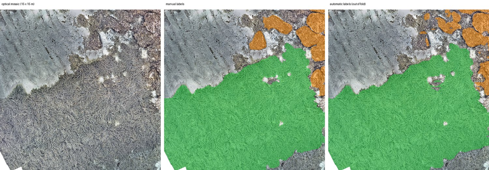
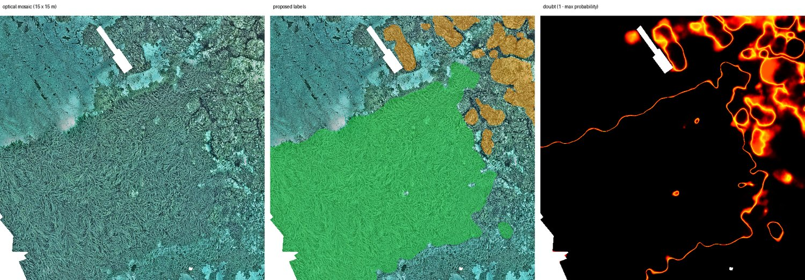

# optical_labeler

Automatic proposal of seabed labels — **Posidonia, dead Posidonia (matte), rock, sand and other
bottom** — on georeferenced optical mosaics (AUV camera). A U-Net on RGB proposes the masks. A person reviews them in a GIS, and the result is a set
of masks in the same format as hand-drawn ones, usable wherever manual masks are used; for example,
to label co-registered side-scan sonar mosaics.

## Workflow

1. **Train** on optical mosaics that have manual masks (`configs/sites.yaml`).
2. **Propose** labels on a new optical mosaic: masks, probabilities, a doubt map and GeoJSON
   polygons.
3. **Review** the polygons in a GIS (QGIS), correcting their class or shape.
4. **Convert** the reviewed polygons back to masks.

## Data

Data are not versioned. `docker-compose.yml` mounts the `OPTICAL_DATA` directory (by default
`../sss_segmentation/bagfiles`) read-only at `/workspace/data`, and the paths in
`configs/sites.yaml` are relative to `/workspace`. No script writes to `data/`.

Input format:

- **Optical mosaic**: RGB or RGBA GeoTIFF. The alpha band marks the valid pixels (without alpha,
  the non-black pixels are valid).
- **Manual masks**: grayscale PNG, 255 = class, drawn on a copy of the mosaic downscaled by any
  factor (they are resampled to the working grid). One per class: `posidonia_mask`,
  `dead_posidonia_mask`, `rock_mask`, `sand_mask`, `other_mask`, plus `ignore_mask` for pixels to
  leave out and `area_mask` for the annotated area.

Sites may be annotated partially. Each site declares in `annotated` the classes whose extent is
complete there (by default, the classes it has a mask for). An annotated pixel outside every mask
is only known to be one of the other classes, and training treats it that way: with Posidonia and
rock annotated, such a pixel may be dead matte, sand or other bottom, without saying which. A few
polygons of sand or dead matte are therefore enough to add those classes to a site whose
Posidonia and rock were mapped completely.

The working resolution is the mosaic resolution reduced by `factor` (~2.6 cm/px with x4 mosaics).

## Setup

```bash
docker compose build                                                   # CPU image
docker compose -f docker-compose.yml -f docker-compose.gpu.yml build   # CUDA image
```

With a GPU, `OPTICAL_GPU` selects the card by its `nvidia-smi` index:

```bash
OPTICAL_GPU=1 docker compose -f docker-compose.yml -f docker-compose.gpu.yml run --rm labeler <command>
```

## Usage

```bash
# Spatial cross-validation on one site (blocks from configs/sites.yaml)
docker compose run --rm labeler python scripts/train.py --protocol cv --site andratx_135222

# Train on a whole site and test on others
docker compose run --rm labeler python scripts/train.py --protocol transfer \
    --site andratx_135222 --test pollenca_134616

# Label proposal on an optical mosaic (mean of the given models)
docker compose run --rm labeler python scripts/auto_label.py \
    --models 'runs/optical_r34/transfer/all/seed*/model.pt' --mosaic <mosaic.tif> --out <prefix>

# Reviewed polygons → masks (optionally clipped to the reviewed area)
docker compose run --rm labeler python scripts/masks_from_vectors.py --vectors <prefix>_labels.geojson \
    --mosaic <mosaic.tif> --out <reviewed_prefix> [--area <area.geojson>]
```

`train.py` writes to `runs/<model>/<protocol>/<split>/seed<k>/` the model (`model.pt`), the metrics
(`metrics.json`, IoU counts per class and test site) and the class probabilities over the test
mosaic (`prob_<site>.tif`).

`auto_label.py` reduces the mosaic to the resolution the models were trained at. Models saved
without that resolution need it through `--train-res-m`. It writes:

| file | content |
|---|---|
| `<prefix>_<class>.png` | one mask per predicted class (`posidonia`, `dead_posidonia`, `rock`, `sand`, `other`) in the format of the manual ones |
| `<prefix>_prob.tif` | class probabilities (uint8 0..250; one band per class, named in the band descriptions) |
| `<prefix>_doubt.tif` | band 1: 1 − highest probability; band 2: standard deviation of P(Posidonia) between models |
| `<prefix>_labels.geojson` | polygons of every class (mosaic CRS) with a `class` property and their mean probability and doubt |

Models trained with the earlier three outputs (other bottom, Posidonia, rock) are still accepted
and write only the Posidonia and rock masks.

When reviewing in the GIS, every polygon keeps its `class` property: `posidonia`,
`dead_posidonia`, `rock`, `sand`, `other`, or `ignore` for objects to leave out (man-made targets,
for example). `masks_from_vectors.py` only reads that property and refuses any other value. Where
polygons overlap, the priority is `ignore` > `rock` > `dead_posidonia` > `sand` > `other` >
`posidonia`, so patches of other bottom can be drawn on top of a Posidonia polygon without cutting
it. It writes `<reviewed_prefix>_<class>.png` for every class and `ignore`; with `--area` (a
GeoJSON of the reviewed area) every mask is clipped to that area and `_area.png` is written too.
The polygons must be in the CRS of the mosaic.

## Results

Models with three classes (Posidonia, rock, other bottom), trained on the Andratx mosaic (13_52_22,
~1320 m² of manual masks at 2.6 cm/px) with spatial three-fold cross-validation over 5 m blocks,
three seeds; IoU against the manual masks, ignoring a 0.1 m band around Posidonia boundaries:

| test | Posidonia | rock | other |
|---|---|---|---|
| Andratx, out of fold | 0.977 ± 0.004 | 0.702 ± 0.005 | 0.89 |
| Pollença (another site, not seen in training; rock not annotated) | 0.913 ± 0.032 | — | — |



*Andratx. Left to right: the optical mosaic, the manual labels and the labels proposed by models
that never saw this area (green Posidonia, orange rock).* Most disagreements lie within a few
centimetres of a boundary; the main confusion is between rock and other bottom.



*A mosaic without labels (a second Andratx mission). Left to right: the mosaic, the proposed
labels and the doubt map written by `auto_label.py`.* Doubt concentrates on boundaries and on
rock; where the models disagree, errors are about ten times more frequent than where they agree,
so the doubt map is a guide for review.

The training labels contain only dense, continuous meadow. On sites with sparse meadow, other
illumination or mosaics without photometric correction, the proposals miss much of the meadow and
need review before use.

## Tests

```bash
docker compose run --rm labeler          # runs python -m unittest discover
```

## Licenses

Dependencies are listed in `requirements.txt` with pinned versions and their licenses; torch and
torchvision are installed in the `Dockerfile`. None is GPL.
